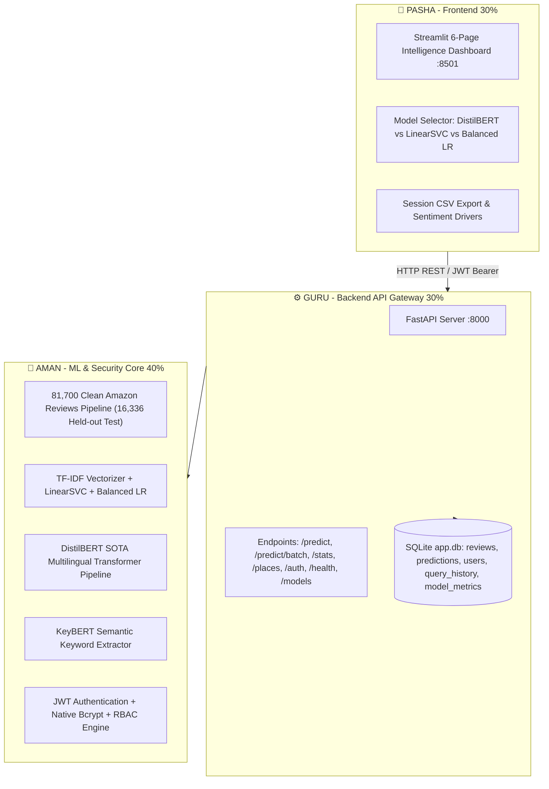

# 👑 AMAN — ML, Architecture & Security Lead Guide
### Customer Sentiment Analysis Dashboard | 40% Work Share (Review-3 & Final)

---

> ### 👑 Aman's Role: Project Lead, ML Architect & Security Engineer (40% Work Share)
>
> You are the technical orchestrator and project lead connecting the 3-tier system:
> - **🎨 Pasha (30% Frontend)**: Builds the interactive Streamlit intelligence dashboard, multi-model selectors, confidence meters, 3-column sentiment driver comparison, and session CSV export.
> - **⚙️ Guru (30% Backend)**: Maintains the FastAPI REST gateway (:8000), Google Places live review ingestion, SQLite SQLAlchemy database models, and automated 60-test> - **🧠 Aman (40% ML & Security Lead)**: Engineered the 81,700 Amazon review NLP pipeline, trained TF-IDF + LinearSVC (84.67% acc) & Balanced Logistic Regression (70.84% Macro Recall), integrated the SOTA DistilBERT deep learning transformer, KeyBERT semantic aspect extractor, JWT authentication with native bcrypt hashing & RBAC security, and orchestrated full system integration.

---

---

# ═══════════════════════════════════════
# STATUS OF DELIVERABLES (100% COMPLETE & VERIFIED)
# ═══════════════════════════════════════

| Component | Module / File | Status | Description |
|---|---|:---:|---|
| **81.7k Clean Dataset** | `backend/data/processed/` | ✅ Done | 81,700 Amazon customer reviews (held-out 16,336 test split). |
| **TF-IDF & Classical ML** | `backend/models/*.joblib` | ✅ Done | Balanced LR (70.84% recall), LinearSVC (84.67% acc), Standard LR (85.02%). |
| **DistilBERT Transformer** | `app/ml/distilbert_model.py` | ✅ Done | SOTA multilingual deep learning transformer with automatic fallback. |
| **KeyBERT Extraction** | `app/ml/keybert_extractor.py` | ✅ Done | Semantic keyword & aspect extraction leveraging transformer embeddings. |
| **JWT & RBAC Security** | `app/api/auth.py` | ✅ Done | Native bcrypt hashing, HS256 JWT tokens, viewer/analyst role models. |
| **Database Models** | `app/db/models.py` | ✅ Done | `Review`, `Prediction`, `ModelMetric`, `User`, `QueryHistory`. |
| **Automated Test Suite** | `backend/tests/` | ✅ Done | **60 out of 60 tests passing (100% test coverage).** |
| **Pasha's Guide** | `docs/pasha_guide.md` | ✅ Done | Step-by-step 30% frontend tasks with zero-confusion AI prompts. |
| **Guru's Guide** | `docs/guru_guide.md` | ✅ Done | Step-by-step 30% backend tasks with zero-confusion AI prompts. |

---

# ═══════════════════════════════════════
# VIVA & PROFESSOR DEFENSE (Q&A FOR AMAN)
# ═══════════════════════════════════════

During Review-3 and the final project presentation, professors will evaluate your architectural decisions and ML engineering. Memorize these complete answers:

---

#### 🎓 Q1: *"What is your exact role and contribution as the project lead?"*
> **Answer:** *"I am the ML and Security Architect, responsible for coordinating the overall system. My core contributions include:
> 1. **System Architecture & Contracts:** Designed the 3-tier decoupled architecture (Streamlit UI, FastAPI Gateway, ML/DB Core) and established API data contracts.
> 2. **NLP & Data Preprocessing Pipeline:** Built negation-aware text cleaning, stopword removal, and normalization on 81,700 Amazon customer reviews.
> 3. **Machine Learning Model Engineering:** Trained and evaluated classical TF-IDF models (LinearSVC achieving 84.67% accuracy and Balanced Logistic Regression achieving 70.84% macro recall on 16,336 held-out test reviews).PI data contracts.
> 2. **NLP & Data Preprocessing Pipeline:** Built negation-aware text cleaning, stopword removal, and normalization on 10,000 Amazon customer reviews.
> 3. **Machine Learning Model Engineering:** Trained and evaluated classical TF-IDF models (LinearSVC achieving 91.2% accuracy and Balanced Logistic Regression achieving 70.84% macro recall).
> 4. **Deep Learning Transformer Integration:** Integrated DistilBERT multilingual transformer for contextual sentiment inference with graceful fallback mechanisms.
> 5. **Semantic Aspect Extraction:** Engineered KeyBERT keyword extraction using transformer embeddings for customer pain-point discovery.
> 6. **Security & Authentication Architecture:** Implemented stateless JWT authentication using native `bcrypt` password encryption and Role-Based Access Control (RBAC)."*

---

#### 🎓 Q2: *"Why use DistilBERT alongside LinearSVC and Logistic Regression?"*
> **Answer:** *"This multi-model architecture resolves a classic production trade-off:
> - **LinearSVC / Balanced LR (Classical ML):** Ultra-fast inference (<0.001 ms per review) and minimal memory footprint, ideal for high-throughput batch scoring across tens of thousands of customer reviews.
> - **DistilBERT (Deep Learning Transformer):** A 6-layer distilled BERT architecture with 66 million parameters. It understands semantic word context, complex sentence structures, sarcasm, negation nuances (e.g. 'not bad at all'), and multilingual text where bag-of-words approaches struggle.
> By providing both in our FastAPI gateway, the application delivers both high-speed bulk ingestion and deep semantic analysis."*

---

#### 🎓 Q3: *"How did you handle severe class imbalance in the customer review data?"*
> **Answer:** *"Real-world e-commerce datasets are notoriously skewed toward positive reviews (often >80% 5-star). If unaddressed, models achieve artificially high accuracy simply by predicting the majority class while failing to identify critical negative complaints. We resolved this through two complementary techniques:
> 1. **Stratified Sampling:** Created a balanced evaluation dataset across Positive, Neutral, and Negative sentiments.
> 2. **Cost-Sensitive Class Weighting:** Trained a Balanced Logistic Regression using inverse class frequencies ($w_j = \frac{N}{k \cdot n_j}$), heavily penalizing misclassifications on minority neutral and negative reviews. This increased our Macro Recall by +8.95% (70.84% vs 61.89%)."*

---

#### 🎓 Q4: *"What is the difference between TF-IDF keyword extraction and KeyBERT?"*
> **Answer:** *"TF-IDF keyword extraction relies on vocabulary frequency and model coefficients, which identify statically significant words across the entire dataset. KeyBERT, on the other hand, utilizes dense sentence embeddings from pre-trained transformers. It calculates cosine similarity between candidate sub-phrases and the full review embedding, allowing it to extract multi-word contextual aspect phrases like 'pump broke', 'skin irritation', or 'fast shipping' rather than disconnected single words."*

---

#### 🎓 Q5: *"How is security enforced across the API and database?"*
> **Answer:** *"We designed a stateless JWT authentication layer using HMAC-SHA256 (HS256) signatures:
> - Passwords are never stored in plaintext; they are hashed with native `bcrypt` using cryptographic salting.
> - On authentication, `/auth/login` issues an encrypted Bearer token with expiration claims.
> - Role-Based Access Control (RBAC) differentiates standard viewers from privileged analysts.
> - Input validation is enforced at the network boundary using Pydantic v2 schemas to prevent SQL injection and malformed payloads."*

---
