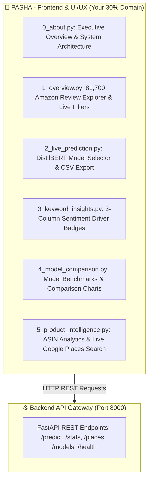

# 🎨 PASHA'S COMPLETE FRONTEND DEVELOPER GUIDE
### Customer Sentiment Analysis Dashboard — Your 30% Work Share
**Personalized Guide for Pasha | Review-3 & Final Evaluation**

---

> ### 👋 Hey Pasha! Read this entire guide before starting.
>
> - **You do NOT need to write complex code by hand.** Your primary tool is **Antigravity IDE**, an AI-powered code editor.
> - You just copy and paste the prompt boxes from this guide into the **Antigravity AI Chat panel**, and the AI will write, test, and polish the code for you!
> - **Your Domain:** You only work inside the `mini/frontend/` folder. Never touch `mini/backend/`.
> - **No Login Blockers:** The dashboard is open and directly accessible at `http://localhost:8501` without any login screen or blocker getting in your way.
> - **Your Mission:** Deliver a stunning, interactive, 6-page Streamlit analytics dashboard with live multi-model prediction (DistilBERT Transformer, Balanced Logistic Regression, LinearSVC), 3-column sentiment driver badge insights, product intelligence analytics, and CSV session history exports.

---



---

# ═══════════════════════════════════════
# PART 1 — ONE-TIME SETUP (5 MINUTES)
# ═══════════════════════════════════════

Follow these steps once to get your workspace ready:

### 🔹 Step 1 — Open Antigravity IDE
1. Open **Antigravity IDE** on your computer.
2. Sign in if prompted.
3. Wait 30 seconds for the interface to load.

---

### 🔹 Step 2 — Clone the Project to Your Desktop
1. Press `Win + R` → type `powershell` → press **Enter**.
2. Run these commands:
   ```powershell
   cd C:\Users\$env:USERNAME\Desktop
   git clone https://github.com/amanydvvv/CUSTOMER-SENTIMENT-ANALYSIS-DASHBOARD.git mini
   cd mini
   ```

---

### 🔹 Step 3 — Switch to Your Dedicated Branch
Create your isolated branch so your work stays organized and safe:
```powershell
git checkout -b feature/pasha-frontend
git branch
```
*(You will see `* feature/pasha-frontend` with a green asterisk).*

---

### 🔹 Step 4 — Open the Project in Antigravity IDE
1. In Antigravity IDE, click **File → Open Folder**.
2. Select the `mini` folder from your Desktop.
3. Open the **AI Chat panel** (`Ctrl + Shift + I` or click the AI icon on the right sidebar).

---

### 🔹 Step 5 — One-Click Server Launch
Copy this entire prompt and paste it into the **Antigravity AI Chat panel**, then press Enter:

```
Please set up my local environment and start both servers:
1. From the mini/ root directory, run: pip install -r requirements.txt
2. From the mini/backend/ directory, run: pip install -r requirements.txt
3. Download required NLTK resources:
   python -c "import nltk; nltk.download('stopwords'); nltk.download('punkt'); nltk.download('wordnet')"
4. Launch the FastAPI backend server in background:
   python -m uvicorn app.main:app --reload --port 8000 (from backend/ directory)
5. Launch the Streamlit frontend dashboard in background:
   python -m streamlit run frontend/streamlit_app.py --server.port 8501 (from mini/ root)
6. Tell me when both http://localhost:8000/docs and http://localhost:8501 are live and give me the links.
```

Once the AI finishes, open `http://localhost:8501` in your browser!

---

# ═══════════════════════════════════════
# PART 2 — TOUR OF YOUR 6 DASHBOARD PAGES
# ═══════════════════════════════════════

Here is the breakdown of what your frontend contains:

| Page | File | What It Does |
|---|---|---|
| **0. Executive Overview** | `frontend/pages/0_about.py` | Shows project background, 3-tier architecture, and system capabilities. |
| **1. Overview** | `frontend/pages/1_overview.py` | Explores 81,700 genuine Amazon reviews with real-time sentiment filtering and donut charts. |
| **2. Live Prediction** | `frontend/pages/2_live_prediction.py` | Allows users to test any review text with **DistilBERT Transformer**, Balanced LR, LinearSVC, confidence gauge, and CSV export. |
| **3. Keyword Insights** | `frontend/pages/3_keyword_insights.py` | Aspect & keyword analysis with 3 side-by-side columns of colored sentiment badges. |
| **4. Model Comparison** | `frontend/pages/4_model_comparison.py` | Compares Accuracy, Macro F1, Recall, and latency across all machine learning models. |
| **5. Product Intelligence** | `frontend/pages/5_product_intelligence.py` | Deep-dive ASIN complaint categories (packaging, scent, quality) + Live Google Places search. |

---

# ═══════════════════════════════════════
# PART 3 — PASHA'S STEP-BY-STEP TASKS
# ═══════════════════════════════════════

> **How to execute each task:** Copy the prompt box under each task, paste it into the **Antigravity AI Chat panel**, and let the AI do the work. Then follow the **Verification Checklist** to check the result in your browser at `http://localhost:8501`.

---

### 🚀 Task 1: Verify All 6 Pages Load Cleanly
**Goal:** Confirm the entire dashboard runs with smooth dark-mode UI and zero login friction.

📋 **Paste this prompt into Antigravity AI Chat:**
```
Please inspect all files in frontend/pages/ (0_about.py to 5_product_intelligence.py):
1. Ensure the dashboard loads directly without any login walls or modal blockers.
2. Ensure all API calls to the backend have graceful error handling with informative toasts if the backend is temporarily offline.
3. Test that navigation across all 6 pages at http://localhost:8501 is smooth, reactive, and error-free.
```

✅ **Verification Checklist:**
- Open `http://localhost:8501` in Chrome or Edge.
- Click each of the 6 pages in the sidebar.
- Confirm there are no red error boxes or crashed widgets.

---

### 🚀 Task 2: Verify the DistilBERT Model Selector & Inference
**Goal:** Ensure the Live Prediction page offers DistilBERT as the default SOTA model alongside classical baselines.

📋 **Paste this prompt into Antigravity AI Chat:**
```
In frontend/pages/2_live_prediction.py:
1. Confirm the "Inference Model" selectbox displays these 4 options with exact labels:
   - "distilbert" -> "⚡ DistilBERT Transformer (Deep Learning — Multilingual SOTA)" (DEFAULT)
   - "balanced_logistic_regression" -> "Balanced Logistic Regression (Fast TF-IDF Baseline)"
   - "logistic_regression" -> "Standard Logistic Regression"
   - "linearsvc" -> "LinearSVC (High Accuracy SVM)"
2. When the user enters text and clicks "ANALYZE REVIEW":
   - Render a colored sentiment badge (🟢 Positive, ⚪ Neutral, 🔴 Negative).
   - Render a percentage confidence score (e.g., 94.8% Confidence).
   - Render the inference latency in milliseconds.
3. Ensure batch review analysis works when multiple lines of reviews are pasted.
```

✅ **Verification Checklist:**
- Go to `http://localhost:8501` → click **2_live_prediction**.
- Check that the model dropdown defaults to **⚡ DistilBERT Transformer**.
- Type: *"The texture is great and it arrived on time, but the bottle was slightly leaking."*
- Click **ANALYZE REVIEW** → Verify you see the sentiment, confidence bar, and response time.

---

### 🚀 Task 3: Test Session History & Download CSV Export
**Goal:** Allow users to download all their live predictions as a clean CSV file.

📋 **Paste this prompt into Antigravity AI Chat:**
```
In frontend/pages/2_live_prediction.py:
1. In the "Analysis History (This Session)" section:
   - Ensure every analyzed review is saved to st.session_state["analysis_history"].
   - Add a "📥 Download History as CSV" button using st.download_button.
   - File output name should be: "sentiment_analysis_session.csv".
   - Include columns: Timestamp, Review Snippet, Predicted Sentiment, Confidence, Model Used.
2. Add a "🗑️ Clear History" button to reset the table.
```

✅ **Verification Checklist:**
- Analyze 2 or 3 different reviews.
- Scroll down to the session history section.
- Click **📥 Download History as CSV** → Verify a CSV file downloads to your computer and opens properly in Excel/Notepad.

---

### 🚀 Task 4: Polish About Page with 3-Tier Team Roles
**Goal:** Ensure the About page clearly displays team responsibilities and project architecture.

📋 **Paste this prompt into Antigravity AI Chat:**
```
In frontend/pages/0_about.py:
1. Update the Team Roles section to display 3 clean, dark-themed cards:
   - 👑 Aman (40% Work Share) — ML & Security Architect:
     Built 10,000 Amazon dataset NLP pipeline, DistilBERT transformer integration, KeyBERT semantic keyword extraction, LinearSVC/Balanced LR training, and JWT RBAC security architecture.
   - ⚙️ Guru (30% Work Share) — Backend & API Developer:
     FastAPI REST Gateway (:8000), Google Places live review ingestion, SQLite SQLAlchemy database models, and automated 60-test pytest suite.
   - 🎨 Pasha (30% Work Share) — Frontend & UI/UX Developer:
     Streamlit 6-page intelligence dashboard, DistilBERT multi-model live prediction interface, 3-column sentiment driver comparison, and session CSV export.
2. Include the system architecture diagram card showing Client Tier, API Gateway, and ML Core.
```

✅ **Verification Checklist:**
- Go to `http://localhost:8501` → click **0_about**.
- Confirm all 3 team cards and architecture details render crisply.

---

### 🚀 Task 5: Enhance Keyword Insights with 3-Column Sentiment Badges
**Goal:** Deliver a side-by-side comparative breakdown of positive, neutral, and negative drivers.

📋 **Paste this prompt into Antigravity AI Chat:**
```
In frontend/pages/3_keyword_insights.py:
1. Add a section titled "📊 Side-by-Side Sentiment Driver Comparison".
2. Create 3 balanced columns:
   - Col 1: "🟢 Positive Drivers" (Green badges, #22C55E)
   - Col 2: "⚪ Neutral Aspects" (Amber badges, #F59E0B)
   - Col 3: "🔴 Negative Signals" (Red badges, #EF4444)
3. Load the top 10 keywords for each sentiment category from the backend /stats/keywords/{sentiment} endpoint or fallback dataset.
4. Render each keyword as a badge tag with clean typography.
```

✅ **Verification Checklist:**
- Open **3_keyword_insights**.
- Scroll down to verify the 3 side-by-side columns with green, amber, and red keyword tags.

---

### 🚀 Task 6: Verify Product Intelligence & Live Google Places Search
**Goal:** Confirm ASIN complaint categories and Google Places live business review analysis work.

📋 **Paste this prompt into Antigravity AI Chat:**
```
In frontend/pages/5_product_intelligence.py:
1. In the ASIN Product Analytics tab:
   - Verify selecting a product ASIN displays a sentiment donut chart and pain-point categories (Packaging, Scent, Texture, Delivery, Price).
2. In the Live Google Places Search tab:
   - Verify typing a query like "Sephora" or "Starbucks" calls the backend and displays real customer review text and instant sentiment classifications.
   - Confirm it uses cached fallback reviews if no live Google API key is configured.
```

✅ **Verification Checklist:**
- Open **5_product_intelligence**.
- Test both the ASIN Product tab and the Google Places search tab.

---

# ═══════════════════════════════════════
# PART 4 — SAVE & PUSH YOUR WORK (GIT)
# ═══════════════════════════════════════

Once you have verified all tasks in your browser:

### 1. Check What You Changed
In the Antigravity Terminal (bottom panel):
```powershell
git status
```

### 2. Stage and Commit Your Work
```powershell
git add frontend/
git commit -m "feat(frontend): complete 6-page dashboard, DistilBERT selector, CSV export, team cards, and keyword badges"
```

### 3. Push to GitHub
```powershell
git push origin feature/pasha-frontend
```

### 4. Send a Message to Aman
> *"Hey Aman, I've finished all frontend features and verified all 6 pages at http://localhost:8501. My changes are pushed to `feature/pasha-frontend`. Ready for merge into main!"*

---

# ═══════════════════════════════════════
# PART 5 — PASHA'S VIVA / PRESENTATION DEFENSE Q&A
# ═══════════════════════════════════════

During Review-3 and final presentations, professors will ask questions about your frontend implementation. Memorize these answers:

---

#### 🎓 Q1: *"Pasha, what is your exact contribution to this project?"*
> **Answer:** *"I am the Frontend and UI/UX Developer, responsible for 30% of the project. I developed the multi-page Streamlit intelligence dashboard encompassing 6 modular pages:
> 1. **About Page:** System architecture visualization and team role breakdown.
> 2. **Reviews Overview:** Real-time filtering and exploration of 10,000 Amazon customer reviews.
> 3. **Live Prediction:** Single and batch review scoring with multi-model selection (DistilBERT transformer, Balanced Logistic Regression, LinearSVC) and CSV session export.
> 4. **Keyword Insights:** TF-IDF and KeyBERT aspect extraction with side-by-side 3-column sentiment driver badges.
> 5. **Model Comparison:** Side-by-side empirical benchmark metrics (Accuracy, Macro F1, Recall, Latency).
> 6. **Product Intelligence:** ASIN-level pain-point classification and live Google Places business review ingestion."*

---

#### 🎓 Q2: *"How does the frontend communicate with the backend?"*
> **Answer:** *"All frontend communication is routed through a centralized API client in `frontend/api_client.py`. It sends asynchronous HTTP REST requests using `requests`/`httpx` to the FastAPI backend running on port 8000 (such as `POST /predict`, `GET /stats/keywords`, `GET /places/reviews`). If the backend server is temporarily offline, the API client catches the exception and falls back to cached local dataset loaders so the dashboard never crashes."*

---

#### 🎓 Q3: *"Why did you provide multiple models in the Live Prediction dropdown?"*
> **Answer:** *"Different business use cases require different trade-offs between speed and semantic depth:
> - **DistilBERT Transformer:** A state-of-the-art 66-million parameter deep learning model from HuggingFace that excels at understanding context, negations, sarcasm, and multilingual text.
> - **Balanced Logistic Regression & LinearSVC:** Classical TF-IDF models that offer ultra-low latency (under 1 millisecond) for high-throughput batch processing.
> Giving the user a dropdown selector empowers analysts to choose between maximum deep-learning contextual accuracy or instant batch scoring."*

---

#### 🎓 Q4: *"How does the Product Intelligence and Pain-Point analysis work?"*
> **Answer:** *"The Product Intelligence page filters reviews for a specific product ASIN and passes negative customer reviews through an aspect-extraction pipeline. It categorizes complaints into key operational pain points such as Packaging, Scent, Texture, Delivery, and Value. We visualize this using a prioritized issue severity matrix and a sentiment donut chart, helping product managers immediately pinpoint why customers are dissatisfied."*

---

#### 🎓 Q5: *"Why did you choose Streamlit instead of React or plain HTML?"*
> **Answer:** *"Streamlit enables rapid reactive data visualization and seamless Python-native integration with machine learning pipelines, Pandas dataframes, and Plotly charts. It allows us to deliver rich interactive components — such as confidence gauges, real-time filters, CSV export triggers, and multi-column comparison grids — while maintaining clean separation of concerns from the FastAPI backend."*

---
